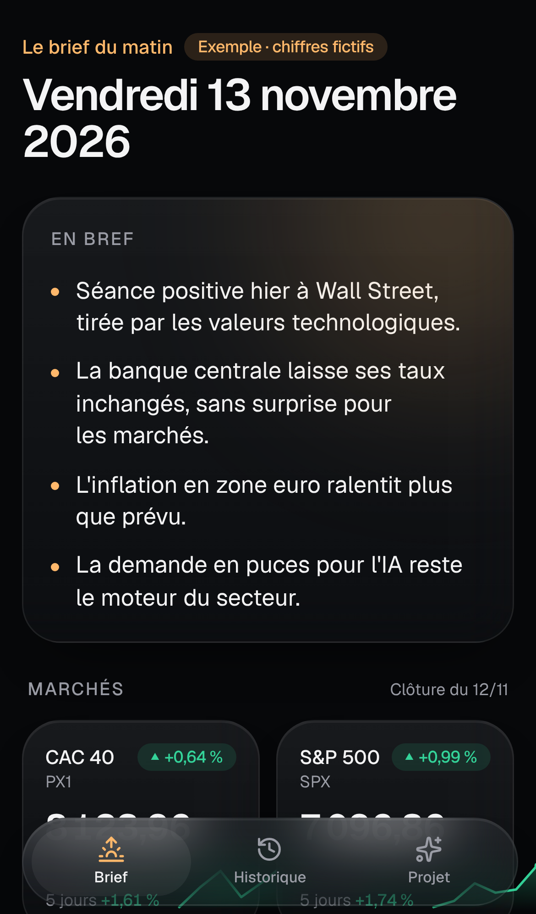
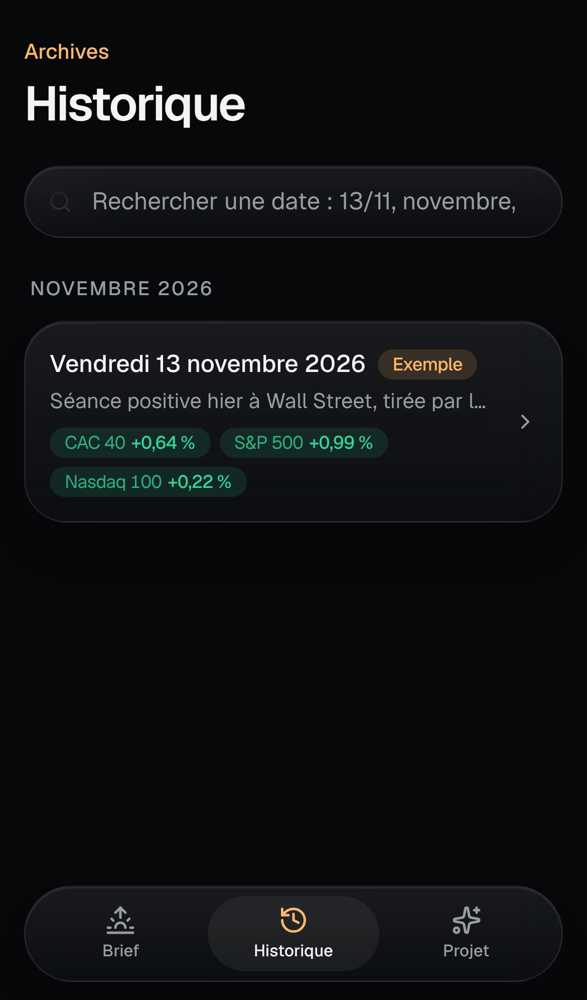
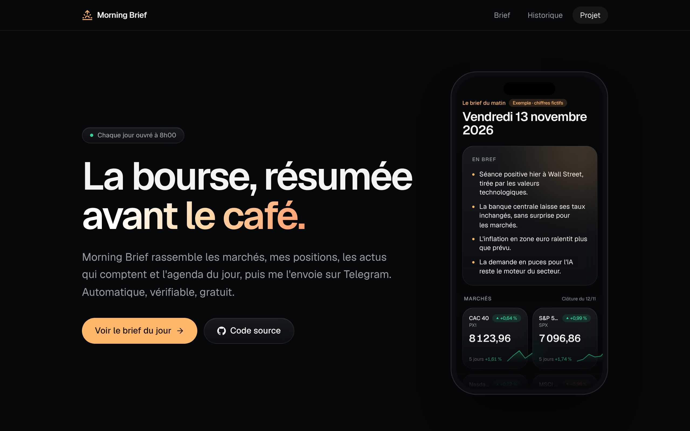
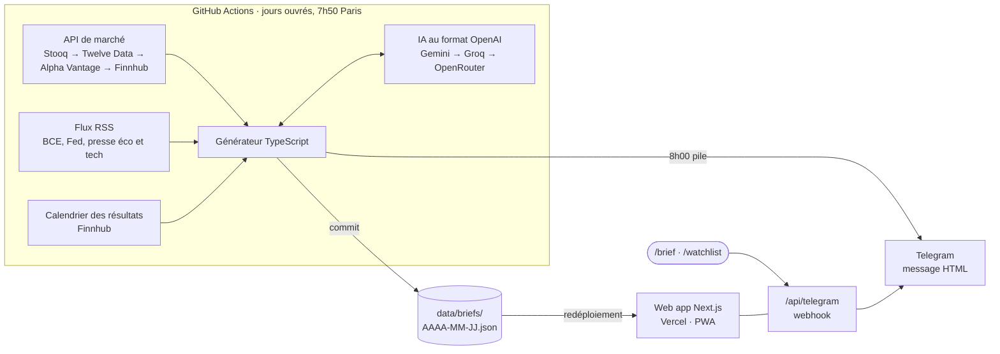

# ☀️ Morning Brief

**La bourse, résumée avant le café.** Chaque jour ouvré à 8h00 (heure de Paris), Morning Brief rassemble les marchés, mes positions, les actus qui comptent et l'agenda du jour, puis :

1. l'envoie sur **Telegram**, dans un message lisible sur iPhone ;
2. le publie sur une **web app installable** (PWA), avec l'historique.

Le tout sans serveur à maintenir et pour **0 €**.

| Web app (iPhone) | Historique | Page projet |
| --- | --- | --- |
|  |  |  |

> Les captures montrent le **brief d'exemple** livré avec le dépôt : ses chiffres et ses actualités sont fictifs.

## Sommaire

- [Ce que contient le brief](#ce-que-contient-le-brief)
- [Architecture](#architecture)
- [Choix techniques](#choix-techniques)
- [Démarrage rapide](#démarrage-rapide)
- [Installation pas à pas](#installation-pas-à-pas)
- [Configuration](#configuration)
- [Commandes](#commandes)
- [Coûts et limites des offres gratuites](#coûts-et-limites-des-offres-gratuites)
- [Ce qui reste à valider](#ce-qui-reste-à-valider)

## Ce que contient le brief

- **En bref** : 5 lignes maximum, en tête.
- **Marchés** : CAC 40, S&P 500, Nasdaq 100, MSCI World, avec la variation de la veille et la tendance sur 5 séances.
- **Mes positions** : les ETF et actions de `config/watchlist.json`.
- **Actus** : 3 à 5 actualités (macro, taux, tech/IA), une phrase chacune, avec la source et le lien.
- **À surveiller aujourd'hui** : publications de résultats et événements annoncés.
- Toujours terminé par : *« Information générale, pas un conseil en investissement. »*

## Architecture



```
config/watchlist.json     actifs suivis et leurs sources de cours
config/feeds.json         flux RSS d'actualités
prompts/                  prompt système de l'IA
scripts/brief.ts          point d'entrée de la génération
src/lib/brief/            le cœur : marché, actus, IA, Telegram, horaires (sans dépendance à Next)
src/app/                  web app : /, /historique, /brief/[date], /projet, /api/telegram
data/briefs/              un fichier JSON par brief (écrit par le workflow)
data/sample/brief.json    brief d'exemple, affiché tant qu'aucun vrai brief n'existe
tests/                    tests Vitest + faux réseau réutilisé par le mode démo
.github/workflows/        brief.yml (planification) et ci.yml (tests)
```

## Choix techniques

**Stockage : des fichiers JSON commités, pas de base de données.** Un brief par jour, c'est quelques kilo-octets. Le workflow commite `data/briefs/AAAA-MM-JJ.json` ; ce commit redéploie la web app, qui lit les fichiers au moment du build. Par rapport à Supabase : aucun compte ni secret en plus, un historique versionné et relisible dans GitHub, des pages entièrement statiques. La contrepartie : la web app se met à jour une à deux minutes après l'envoi Telegram, le temps du déploiement.

**Les chiffres viennent des API, jamais de l'IA.** Le code calcule cours et variations. L'IA ne rédige que le résumé, le choix des actus et « à surveiller », dans un JSON validé par un schéma. Elle désigne les actus par identifiant : la source et le lien sont toujours ceux du flux d'origine. Une réponse qui cite une actualité inexistante est rejetée, et on passe au fournisseur suivant.

**Bascule IA.** Gemini, puis Groq, puis chaque modèle gratuit OpenRouter, tous via le même client au format OpenAI. On bascule sur une limite atteinte (429), une panne (5xx), un délai dépassé, un JSON invalide ou un contenu refusé par la validation. Si tout échoue, le brief part quand même avec un **résumé automatique sans IA**, et le signale.

**Sources de cours en chaîne.** Chaque actif liste ses sources dans l'ordre (`config/watchlist.json`). Une source qui échoue laisse la place à la suivante ; si toutes échouent, l'actif est affiché « indisponible » et le reste du brief est intact. Les appels sont espacés pour respecter les limites de débit, avec de nouvelles tentatives sur les erreurs passagères.

**8h00 à Paris, été comme hiver.** GitHub planifie en UTC. Deux crons tournent à 05:50 et 06:50 UTC ; le script vérifie l'heure de Paris et n'agit que dans la fenêtre 7h30–9h30, une seule fois par jour. Le brief est généré vers 7h50, puis le script **attend 8h00 pile** pour l'envoyer. Cette marge absorbe les retards fréquents des crons GitHub ; un test vérifie qu'il y a exactement un brief par jour ouvré sur toute l'année, changements d'heure compris.

**MSCI World.** L'indice n'a pas de flux gratuit : il est suivi via l'ETF iShares MSCI World (URTH), et l'app l'indique.

**Commandes du bot.** `/brief` et `/watchlist` passent par un webhook hébergé dans la web app (`/api/telegram`). Telegram signe chaque appel avec un jeton secret, et le bot ne répond qu'à ton `chat_id`.

**Interface.** Next.js (App Router), Tailwind CSS, composants au format shadcn/ui (`src/components/ui`), police Geist, animations Motion (ex-Framer Motion). Thème sombre unique. La vue du brief utilise des requêtes de conteneur, ce qui permet à la page `/projet` d'afficher la vraie interface dans ses maquettes de téléphone plutôt que des captures.

## Démarrage rapide

Node.js 22 ou plus.

```bash
npm install
```

Aperçu sans aucune clé ni réseau (données fictives) :

```bash
npm run brief:demo
```

La web app :

```bash
npm run dev
```

## Installation pas à pas

Compte 20 à 30 minutes. Rien ne demande de carte bancaire.

### 1. Créer le bot Telegram

1. Dans Telegram, ouvre **@BotFather** et envoie `/newbot`.
2. Donne un nom (ex. *Morning Brief*) puis un identifiant finissant par `bot`.
3. BotFather te donne un **jeton** du type `123456789:AA…` : c'est `TELEGRAM_BOT_TOKEN`.
4. Ouvre la conversation avec ton nouveau bot et envoie-lui `bonjour`.

### 2. Récupérer ton chat_id

Copie `.env.example` en `.env`, colle le jeton dans `TELEGRAM_BOT_TOKEN`, puis :

```bash
npm run telegram:webhook -- --chat-id
```

Le nombre affiché est `TELEGRAM_CHAT_ID`.

### 3. Créer les clés d'API gratuites

| Variable | Où la créer | Rôle |
| --- | --- | --- |
| `GEMINI_API_KEY` | <https://aistudio.google.com/apikey> | IA principale |
| `GROQ_API_KEY` | <https://console.groq.com/keys> | IA de secours |
| `OPENROUTER_API_KEY` | <https://openrouter.ai/settings/keys> | IA de secours |
| `TWELVEDATA_API_KEY` | <https://twelvedata.com/apikey> | ETF Euronext Paris, secours actions US |
| `ALPHAVANTAGE_API_KEY` | <https://www.alphavantage.co/support/#api-key> | Secours cours |
| `FINNHUB_API_KEY` | <https://finnhub.io/dashboard> | Calendrier des résultats, secours actions US |

Stooq ne demande pas de clé. Une seule clé IA suffit pour démarrer ; les trois donnent la bascule complète.

### 4. Vérifier en local

Renseigne les clés dans `.env`, puis teste chaque source de cours :

```bash
npm run check:sources
```

Si un actif n'a aucune source valide, corrige son symbole dans `config/watchlist.json` (voir [Ce qui reste à valider](#ce-qui-reste-à-valider)). Ensuite, l'aperçu réel, sans envoi :

```bash
npm run brief
```

Et un premier envoi sur Telegram :

```bash
npm run brief:send
```

### 5. Ajouter les secrets dans GitHub

Dans le dépôt : **Settings → Secrets and variables → Actions**.

- Onglet **Secrets** : `TELEGRAM_BOT_TOKEN`, `TELEGRAM_CHAT_ID`, `GEMINI_API_KEY`, `GROQ_API_KEY`, `OPENROUTER_API_KEY`, `TWELVEDATA_API_KEY`, `ALPHAVANTAGE_API_KEY`, `FINNHUB_API_KEY`.
- Onglet **Variables** : `APP_URL` (l'URL Vercel, après l'étape 6). Facultatif : `GEMINI_MODEL`, `GROQ_MODEL`, `OPENROUTER_MODELS`.

Vérifie aussi **Settings → Actions → General → Workflow permissions** : *Read and write permissions* (le workflow commite les briefs).

Pour tester sans attendre 8h : **Actions → Morning Brief → Run workflow**.

### 6. Connecter le dépôt à Vercel

1. Sur <https://vercel.com/new>, importe le dépôt. Les réglages par défaut conviennent (Next.js est détecté).
2. Dans **Settings → Environment Variables**, ajoute `TELEGRAM_BOT_TOKEN`, `TELEGRAM_CHAT_ID`, `TELEGRAM_WEBHOOK_SECRET` (une chaîne aléatoire de ton choix), `APP_URL` (l'URL du site) et `NEXT_PUBLIC_GITHUB_URL` (l'URL du dépôt).
3. Redéploie pour que les variables soient prises en compte.

### 7. Brancher les commandes du bot

Dans `.env`, renseigne `APP_URL` et le même `TELEGRAM_WEBHOOK_SECRET` que sur Vercel, puis :

```bash
npm run telegram:webhook
```

Envoie `/brief` ou `/watchlist` à ton bot.

### 8. Installer l'app sur iPhone

Ouvre l'URL Vercel dans **Safari**, touche **Partager**, puis **Sur l'écran d'accueil**. L'app s'ouvre en plein écran, sans barre de navigateur.

## Configuration

### `config/watchlist.json`

```json
{
  "id": "nvda",
  "name": "NVIDIA",
  "symbol": "NVDA",
  "kind": "stock",
  "currency": "USD",
  "sources": [
    { "provider": "stooq", "symbol": "nvda.us" },
    { "provider": "twelvedata", "symbol": "NVDA" },
    { "provider": "finnhub", "symbol": "NVDA" }
  ]
}
```

- `markets` et `positions` : les deux sections du brief. Ajoute, retire ou réordonne librement.
- `kind` : `index`, `etf` ou `stock`. `currency` : `EUR`, `USD`… ou `pts` pour un indice.
- `sources` : essayées dans l'ordre. Fournisseurs : `stooq`, `twelvedata` (option `mic`, ex. `XPAR` pour Euronext Paris), `alphavantage`, `finnhub`.
- `earnings` : les sociétés américaines dont les publications de résultats sont signalées.

### `config/feeds.json`

Les flux RSS ou Atom, avec le nom affiché comme source. `maxAgeHours` fixe l'ancienneté maximale d'une actualité (le lundi, le week-end est inclus).

### `prompts/brief.system.md`

Le prompt système. Le ton, la longueur et les règles de rédaction se règlent ici, sans toucher au code.

## Commandes

| Commande | Effet |
| --- | --- |
| `npm run brief` | Génère le brief et l'affiche. N'envoie et n'enregistre rien. |
| `npm run brief -- --json` | Idem, en affichant le JSON structuré. |
| `npm run brief:demo` | Aperçu hors ligne, sans clés, avec des données fictives. |
| `npm run brief:send` | Génère, enregistre dans `data/briefs/` et envoie sur Telegram. |
| `npm run check:sources` | Teste chaque source de cours de la watchlist. |
| `npm run telegram:webhook` | Branche les commandes du bot (`-- --off` pour débrancher, `-- --chat-id` pour ton identifiant). |
| `npm test` | Tests : génération, bascule IA, format Telegram, horaires. |
| `npm run typecheck` · `npm run lint` | Vérifications statiques. |
| `npm run dev` · `npm run build` | Web app. |

## Coûts et limites des offres gratuites

**Coût total : 0 €.** Les quotas ci-dessous sont ceux connus à l'écriture de ce README ; ils changent, vérifie-les sur le site de chaque service. Le brief consomme une quinzaine de requêtes de marché et un appel IA par jour, très loin de ces plafonds.

| Service | Offre gratuite | Conséquence pour le projet |
| --- | --- | --- |
| GitHub Actions | Illimité sur un dépôt public ; quota mensuel de minutes sur un dépôt privé | Environ 12 min par jour (dont l'attente jusqu'à 8h00). Les crons peuvent démarrer en retard : c'est pour cela que la génération commence à 7h50. |
| Vercel (Hobby) | Usage personnel, non commercial | Un déploiement par brief. |
| Telegram Bot API | Gratuite | Messages limités à 4096 caractères : le brief est découpé au besoin. |
| Google Gemini | Quota quotidien gratuit sur les modèles Flash | Peut être réduit ou saturé : d'où la bascule. |
| Groq | Gratuit avec limites par minute et par jour | Secours. |
| OpenRouter | Modèles `:free` avec un quota quotidien réduit | Secours ; la liste des modèles gratuits évolue (`OPENROUTER_MODELS`). |
| Stooq | Sans clé | Indices et actions US. Pas d'engagement de disponibilité. |
| Twelve Data | 8 requêtes/minute, 800/jour | Les appels sont espacés de 8 s. Certaines places hors États-Unis peuvent être réservées aux offres payantes. |
| Alpha Vantage | 25 requêtes/jour | Utilisé seulement en secours. |
| Finnhub | 60 requêtes/minute | Cotation du jour sans historique : donne la variation de séance, pas la tendance 5 jours. |

Autres limites à connaître :

- **Cours de clôture uniquement.** Le brief part avant l'ouverture : il donne la clôture de la veille, pas de temps réel.
- **Jours fériés.** Le brief part du lundi au vendredi, y compris les jours où une bourse est fermée ; les cours sont alors ceux de la dernière séance.
- **Agenda.** Seules les publications de résultats viennent d'un calendrier. Les annonces de banques centrales et les statistiques n'apparaissent que si une actualité du jour les mentionne : il n'existe pas de calendrier macro gratuit et fiable.
- **Crons en sommeil.** GitHub suspend les workflows planifiés d'un dépôt sans activité pendant 60 jours. Les commits quotidiens des briefs entretiennent cette activité.

## Ce qui reste à valider

Le projet a été développé dans un environnement sans accès aux API externes. Ce qui est vérifié par les tests l'est avec des réponses simulées au format de chaque service ; **aucun appel réel n'a encore été fait**. À contrôler avec tes clés :

- [ ] `npm run check:sources` : chaque actif a au moins une source valide. Les symboles des ETF Euronext Paris (`DCAM`, `PE500`, `PUST`) et leur disponibilité en offre gratuite sont l'inconnue principale.
- [ ] « ETF S&P 500 EUR (Acc) » a été interprété comme l'**Amundi PEA S&P 500 (PE500)**. Si tu détiens un autre fonds (ex. BNP Paribas Easy S&P 500, `ESE`), change `name`, `symbol` et `sources`.
- [ ] `npm run brief` : les flux RSS répondent, et l'IA renvoie un JSON accepté.
- [ ] `npm run brief:send` : le message s'affiche correctement dans Telegram.
- [ ] Un lancement manuel du workflow, puis un premier envoi planifié à 8h00.
- [ ] Le déploiement Vercel, le webhook (`/brief`, `/watchlist`) et l'installation sur iPhone.

---

*Information générale, pas un conseil en investissement.*
